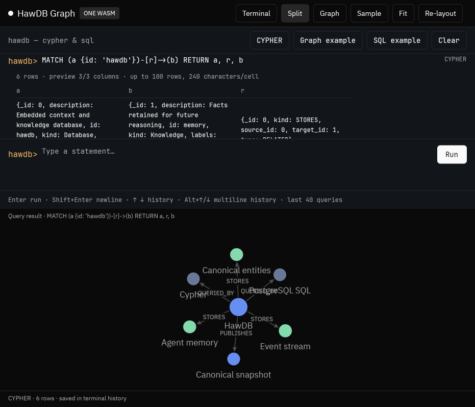
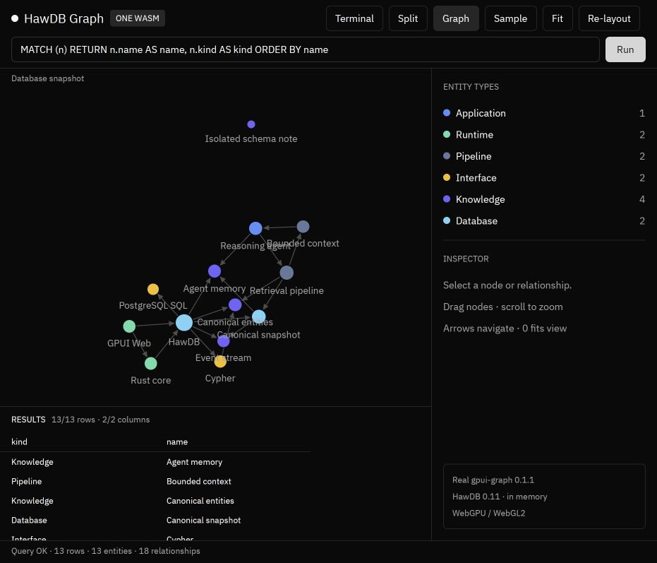
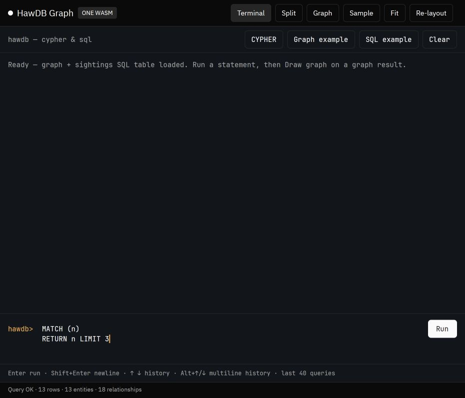
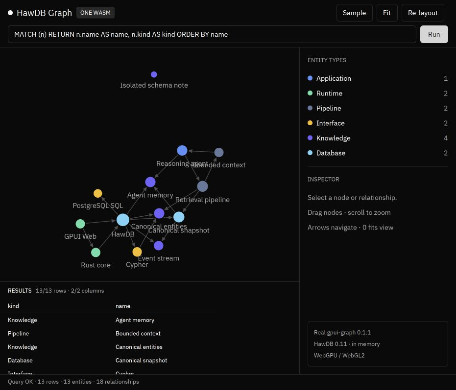
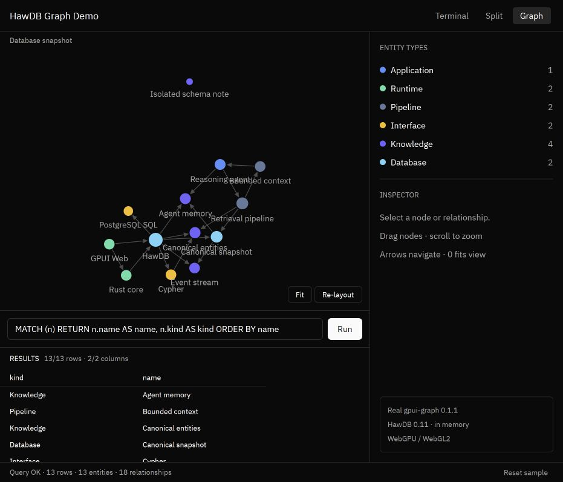

# Validation — 2026-10-19

## Automated

`npm run check` checks formatting, executes thirteen native tests against the real
HawDB database, builds the release WASM, generates browser bindings, checks the
loader syntax, and verifies the generated `run` entrypoint. The unified binary
is approximately 15.7 MiB before HTTP compression after the size optimization below.

Coverage includes sample nodes and relationships, isolated nodes, empty graphs,
create/delete refresh, duplicate and missing identifiers, invalid-query recovery,
UTF-8 query size limits, and bounded result previews. Terminal tests cover SQL
routing, filtered returned subgraphs, native node identities, relationship-only
results, parallel edges, nested values and graph limits, historical snapshots,
failed commands, history bounds, and restoration of draft text and language.

## Terminal follow-up

Checked in the in-app browser:

- A terminal command produces one transcript entry with its result and language.
- Invalid `MATCH n RETURN n` remains inline as an error; later successful results
  append below it without erasing it.
- `Draw graph` opens Split and renders the returned graph objects (12 connected
  sample nodes and 18 relationships for `MATCH (a)-[r]->(b) RETURN a,r,b`).
- Up recalls the previous command; Down restores an empty or unsent draft.
- Shift+Enter inserts a newline without creating a transcript entry. Enter runs
  the multiline `MATCH (n) / RETURN n LIMIT 3` and returns exactly three nodes.
- SQL example returns the three rows in `sightings` through Run.
- The filtered HawDB relationship query returns six rows and draws seven distinct
  nodes with six relationships, rather than the full database graph.
- Crossing Cypher/SQL command history restores each command's language, and
  Alt+Down works when the recalled command has multiple lines. Returning past
  the newest command restores `draft not yet run` and SQL mode.

## Browser

### Graph height and terminal alignment regression

Reproduced the reported blank Graph view before the fix: the sidebar and query
rows rendered, but `h_flex` centered the graph panel instead of stretching it,
leaving its flexible canvas with zero height. Graph and horizontal Split now
stretch their children. Terminal prompts and input use the same 14px font,
20px line height, 60px prompt column, and 8px top inset for the composer.

After rebuilding, checked in the in-app browser:

- Graph displays all 13 nodes and 18 relationships before and after running the
  default query, alongside its 13 result rows.
- Single-line and multiline input align with the prompt and Run button.
- Shift+Enter creates a second line; Enter executes the two-line query once and
  returns three nodes. Draw graph renders those three nodes in Split.
- Returning from Split to Graph preserves the visible plotted nodes.
- A temporary wide viewport exercises horizontal Split with a visible graph;
  the override was reset afterward. Its pixel scaling remains unsuitable for
  precise physical-device sizing assertions.
- `npm run check` passes all 13 tests and the release WASM/bundle checks.

### Existing checks

Checked in the Codex in-app browser at `http://127.0.0.1:8080/`:

- Startup: 13 entities and 18 relationships, including the isolated schema note.
- Default query: 13 returned rows with a scrollable result preview.
- Command+A followed by Enter: replaced the query and created exactly one node
  (14 entities, 18 relationships), with one returned node ID.
- Node selection: inspector showed `demo`, “New idea”, and zero connections.
- Run button: created one relationship (14 entities, 19 relationships).
- Delete query: returned to 13 entities and 18 relationships.
- Invalid Cypher: showed the parse error, cleared the old result preview, and
  kept the existing graph usable.
- Sample: restored the database, default query, and empty inspector.
- No warning or error entries in the browser console on the final page.

The browser viewport override changed canvas pixel scaling, so it did not provide
a reliable physical-device check of responsive breakpoints. The header now uses one row; narrow-screen layout branches still need
physical-device validation.
WebGL2 fallback and touch input were not separately exercised.

The app consumes the input's propagated Enter action so desktop keydown and
browser `beforeinput` cannot submit the same write twice. It also registers
Command editing shortcuts alongside the default WASM Ctrl bindings.

## Demo limits

The database is in memory and resets on reload. Queries execute synchronously on
the browser main thread; result preview limits do not cap database execution or
graph size in the original Graph workspace. That workspace's snapshot adapter
requires unique string, integer, or UUID `id` properties. Terminal result plotting
uses native node identities instead and is capped at 2,000 graph items. A committed
write with invalid visual IDs in the original quick-query toolbar clears its
graph and shows an error until the data is repaired or Sample is restored.

## Header simplification

Renamed the app header, document title and loading screen to HawDB Graph Demo.
The header contains only the name and compact Terminal / Split / Graph tabs.
Graph queries sit below the canvas; Fit and Re-layout sit inside its lower-right
corner. Reset sample remains accessible in the status footer in every view.
Browser checks confirmed the new title and header, query execution returning
13 rows, and the relocated Fit action. All 13 tests and the release build pass.

## Cloudflare production deployment

- URL: https://hawdb-demo.jetsquirrel.cloud
- Worker: `hawdb-demo`, version `bc027c2a-7250-40b2-a7d1-7c305c9a10df`,
  deployed at 100% on 2026-10-19.
- Wrangler dry run and release build passed. Six allowlisted runtime/license
  files were uploaded; the custom domain API reports `enabled: true`.
- Public DNS now returns Cloudflare A/AAAA records. HTTPS returns 200 with
  certificate verification enabled. The HTML matches the local release.
- The 23,939,797-byte WASM is served as `application/wasm`; its SHA-256 matches
  the local build: `6c6d7c241bf738514f7677c6e8afc9df3784285a4670a9d7ee00144661d658a5`.
- Local proxy DNS initially returned a synthetic 198.18.x.x address and normal
  browser connections failed. HTTP verification used `curl --resolve` with a
  public DNS-returned Cloudflare edge IP, retaining hostname and TLS checks.
  An end-to-end production browser check is therefore not yet confirmed;
  local browser interaction checks are recorded above.

### Actual compressed transfer size

Production GET requests on 2026-10-19 confirm that Cloudflare already negotiates
HTTP compression for `application/wasm`. No loader changes or manual decompression
are necessary. Requests explicitly advertised one supported content encoding;
curl saved the encoded response bodies without automatic decompression.

| Encoding | Body bytes transferred | MiB | Reduction |
| --- | ---: | ---: | ---: |
| Uncompressed | 23,939,797 | 22.83 | — |
| Brotli (`br`) | 6,627,823 | 6.32 | 72.3% |
| gzip | 7,262,402 | 6.93 | 69.7% |

Both downloaded compressed bodies decompress byte-for-byte to the deployed WASM,
and `WebAssembly.validate` passes. These are HTTP response-body sizes, excluding
HTTP/TLS overhead; the raw artifact size is not the normal compressed download.

## Executable size optimization

Compared complete builds of the same application, without removing features:

| Build | WASM bytes | MiB |
| --- | ---: | ---: |
| Original: Rust `s`, thin LTO | 23,939,797 | 22.83 |
| Original plus Binaryen `-Oz` only | 20,413,523 | 19.47 |
| Rust `z`, fat LTO, one codegen unit | 18,746,483 | 17.88 |
| Selected: Rust changes plus Binaryen `-Oz` | 16,465,668 | 15.70 |

The selected artifact is 31.2% smaller than the original. Binaryen 132.0.0 is
pinned in the npm lockfile. The build validates the optimized module and public
exports/imports before publishing the staged bundle. Identical inputs reuse a
validated cache keyed by the WASM bytes, optimizer script and Binaryen version.

All 13 native tests pass. Browser checks on the optimized bundle confirm startup,
the 18-row graph query, Draw graph with 12 nodes / 18 relationships, an inline
invalid-Cypher error, and a subsequent successful 3-row SQL query. The browser
console contains no warnings or errors during these checks.

Size-oriented compiler/postprocessing can trade runtime speed and build time for
size; this checks functionality, not a comprehensive performance benchmark. The
optimized artifact is gzip-9 compressible to 6,175,640 bytes in a local check;
the earlier production transfer measurements above describe the original build.

Production version `69f7443c-e752-426a-ac9f-b71efe21173a` now serves the optimized
artifact. A new Brotli GET transferred 5,910,983 bytes (5.64 MiB); decompression
matches the local 16,465,668-byte artifact exactly. SHA-256:
`b53995a9a5c6dc39a09de624493ac23eef0cdbd4bba0823bdd5d9fce099a8969`.
The final `npm run check` passes and confirms an optimizer cache hit. Additional
browser write/delete checks changed the graph from 13 to 14 nodes and back to 13.
Production HTTP checks still use the verified public DNS edge IP because the
local proxy's normal hostname resolution remains unavailable.

## R2 delivery and startup diagnostics — 2026-10-19

- Production version: `ec9a139a-a92e-4232-a6cd-305c3634c3b6`.
- Private R2 bucket `hawdb-demo-assets`, bound as `WASM_BUCKET`. Only SHA-256
  `/wasm/<hash>.wasm` paths are exposed through the existing custom domain.
- Current WASM SHA-256 is unchanged:
  `b53995a9a5c6dc39a09de624493ac23eef0cdbd4bba0823bdd5d9fce099a8969`.
- Production GETs verified both MISS and HIT for all three representations:
  Brotli 4,424,256 bytes; gzip 6,175,640 bytes; identity 16,465,668 bytes.
  Every downloaded representation decompresses byte-for-byte to the local WASM.
  Responses include `X-Wasm-Source: r2`, encoding-specific ETags, and one-year
  immutable/no-transform cache control.
- Production verification found Cache API transformations of pre-encoded response
  bodies. Fixed by caching opaque bytes and applying Content-Encoding only at the
  final response, using `encodeBody: manual`. Encoding selection uses the original
  `request.cf.clientAcceptEncoding`; cache entries explicitly separate variants.
  Delivery revision 2 changes the browser URL as well as the edge cache key.
- App and bindgen JS filenames are content-addressed. R2 uploads finish before
  Worker publication. The build validates cached compressed files by decoding.
- Five delivery/loader tests pass: negotiation, cache isolation and conditional/HEAD
  responses, invalid requests, HTTP failure, and stalled-download abort. The
  production Worker builds successfully with a measured startup time of 1 ms.
- Browser verification using local Worker preview connected to **remote R2**:
  app loads, terminal query returns 18 rows, Draw graph renders 12 nodes/18 edges,
  no browser errors/warnings. Screenshot: `docs/r2-query-graph.jpg`.
  The local workerd only supports compatibility dates through 2026-07-15, so
  the disposable preview configuration uses that date; production stays 2026-10-19.
- Direct production browser navigation from this machine still reports
  ERR_CONNECTION_CLOSED. HTTPS verification uses the public Cloudflare edge IP
  with the original hostname and valid TLS verification. The user's originally
  reported hang has not been reproduced; the new loader now exposes download
  progress, stage-specific status, timeout errors and a Retry button instead of
  an indefinite startup screen.
